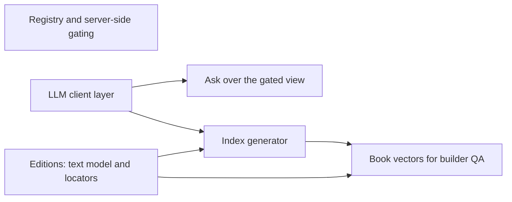

# Research

The research behind Clio, a planned .NET implementation of the [Lorekeeper] open standard for spoiler-safe book companions: what the standard requires, and which technologies an implementation should build on.

> [!NOTE]
> There is no implementation yet; these papers are its starting point. Each paper stands alone and states its question, sources, method, findings and open questions.

## Papers

| Question | Paper | Answer in brief |
| --- | --- | --- |
| What must an implementation reproduce to interoperate with Lorekeeper's reference implementation, its registries and its clients? | [The Lorekeeper standard](lorekeeper-standard.md) | The gating algorithm's output, including its order; the exact bytes behind digests; the static registry paths the reference client relies on; and Python's text and JSON semantics. Most of the standard needs no book text. |
| What would vectorizing books and storing them in PostgreSQL add? | [Book vectorization](book-vectorization.md) | Little at first. Vectorize index items for Ask instead. Book vectors are equivalent to the book's text, so keep them inside the index builder as a later quality aid. |
| Is Microsoft.Extensions.AI the right client abstraction, and which providers does it reach? | [Microsoft.Extensions.AI](microsoft-extensions-ai.md) | Yes, with a thin provider-profile layer. It reaches Anthropic, OpenAI and Azure OpenAI, Gemini, Bedrock, Ollama, and every OpenAI-compatible server. |
| Which parameters matter for small local models, and how close can they get to cloud results? | [Local models](local-models.md) | Send sampling, penalty and context parameters explicitly, and add a dedicated fact-checker plus mechanical validators with one targeted retry. Parity can only be shown statistically. |

## Findings

- **Interoperability is stricter than the specification's conformance rules:**
  - Digests cover the bytes a registry writes, so matching reference registries means serializing exactly as Python's `json.dumps` does.
  - The reference client only uses static registry paths, and skips books in a series.
  - View output order comes from a counter in the reference algorithm, and conformance compares order.
- **A registry and server-side gating need neither book text nor an LLM.** They can come first, before EPUB handling, index generation or Ask.
- **Embeddings belong on index items, not books, at first.** Index items are licensed for sharing and spoiler-safe to rank over a gated view. Book vectors can be inverted back into text, and leak spoilers if ranked before they are filtered.
- **Microsoft.Extensions.AI covers every provider the reference supports.** It needs a small layer for token-limit fields, structured-output fallback, schema rewriting, refusals and timeouts.
- **Small local models need explicit parameters and an independent checker.** Shipped penalties, VRAM-dependent context sizes and silent prompt truncation all degrade results unless overridden. A model checking its own claims rejects almost nothing.

## Implications for the implementation

The findings imply an order, driven by what each capability depends on:

1. **A registry and server-side gating:** no LLM, no book text.
1. **An LLM client layer** on Microsoft.Extensions.AI.
1. **Ask over the gated view**, with index-item embeddings.
1. **Editions:** the EPUB text model, fingerprints and locator resolution.
1. **An index generator** using the local-model profile and a dedicated checker, proven against a benchmark.
1. **Book vectors for builder quality checks**, if the benchmark shows a gain.

## Open questions

| Area | Question | Options | Paper |
| --- | --- | --- | --- |
| Product | Deployment shape | Self-hosted for one user · hosted for many users · a public registry | [Book vectorization](book-vectorization.md) |
| Product | May Ask answer from the book's text? | Never, index only, as the reference promises · opt-in, self-hosted only | [Book vectorization](book-vectorization.md) |
| Protocol | Should a registry compute views and entity lookups? | Yes, for thin clients, learning reading positions · static profile only | [The Lorekeeper standard](lorekeeper-standard.md) |
| Protocol | What does a request without a position return? | `400`, as in the reference · the finished book's view · an explicit parameter | [The Lorekeeper standard](lorekeeper-standard.md) |
| Protocol | Must digests match reference registries byte for byte? | Yes · the weaker §10 guarantee is enough | [The Lorekeeper standard](lorekeeper-standard.md) |
| Protocol | Lookup normalisation | Identifier case · converting ISBN-10 to ISBN-13 | [The Lorekeeper standard](lorekeeper-standard.md) |
| Protocol | Duplicate member names in bundles | Refuse · accept, last value wins, as in the reference | [The Lorekeeper standard](lorekeeper-standard.md) |
| Platform | JSON Schema validator | JsonSchema.Net under the OSMF EULA · another 2020-12 validator | [The Lorekeeper standard](lorekeeper-standard.md) |
| Platform | Target framework and Microsoft.Extensions.AI line | .NET 10 with MEAI 10.11 · .NET 11 with MEAI 11 | [Microsoft.Extensions.AI](microsoft-extensions-ai.md) |
| Platform | Gemini access | The native `Google.GenAI` SDK · the OpenAI-compatible endpoint | [Microsoft.Extensions.AI](microsoft-extensions-ai.md) |
| Models | Local hardware | Apple Silicon · NVIDIA, and how much memory | [Local models](local-models.md) |
| Models | Cloud calls during generation | None · benchmark judge only · auditor for borderline claims | [Local models](local-models.md) |
| Models | Fact-checker licence | Apache-2.0 only · non-commercial acceptable | [Local models](local-models.md) |
| Models | Regression tests for generation | Statistical stability · bit-exact golden outputs | [Local models](local-models.md) |
| Models | Recording the embedder in an index | `promptSet` · a tool sidecar · a new specification field | [Book vectorization](book-vectorization.md) |

## Method

- **Pinned reference.** "The reference" is Lorekeeper's Python implementation at commit [`9c7ebed`][Reference] (v0.13.0, 2026-11-21), and "SPEC §n" a section of its [specification][SPEC] at the same commit.
- **Dates.**
  - The three technology papers were researched on 2026-11-23; package versions, prices and model names are as of that date.
  - The Lorekeeper paper was re-verified on 2026-11-26.
- **Checks.**
  - **Platform behaviour:** run on Python 3.13.14 and on .NET 10.0.15 and 11.0.0.
  - **pgvector:** measured on version 0.8.7 with PostgreSQL 18.7.
  - **Client behaviour:** confirmed by capturing the HTTP requests each adapter sends, with no network.

> [!IMPORTANT]
> Versions, prices and model names change quickly. Re-verify them before acting on any recommendation.

## Attribution

The Lorekeeper specification, JSON Schemas and conformance cases are by the Lorekeeper authors, under [CC BY 4.0]. The reference implementation is under the [Apache License 2.0][Apache-2.0]. The papers summarise and quote them with attribution.

[Lorekeeper]: https://github.com/nightspine/lorekeeper
[Reference]: https://github.com/nightspine/lorekeeper/tree/9c7ebed838b7ecd553e358d470ff6096b3aafdf0
[SPEC]: https://github.com/nightspine/lorekeeper/blob/9c7ebed838b7ecd553e358d470ff6096b3aafdf0/SPEC.md
[CC BY 4.0]: https://creativecommons.org/licenses/by/4.0/
[Apache-2.0]: https://www.apache.org/licenses/LICENSE-2.0
